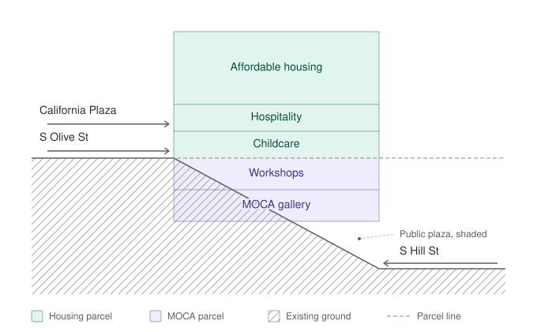

# Angels Knoll Development Proposal: key points draft

Rui Wang, 30 October 2026, updated 8 November 2026 with the Angels Landing draft. This draft has the key points only and is the basis for rewriting the stacked scheme in full. The 29 October version is kept as an archive. Numbers in brackets refer to the sources at the end.

## Executive summary

Before 1959, Bunker Hill was a dense Victorian neighborhood. The Community Redevelopment Agency cleared it under the 1959 redevelopment plan, and superblocks were built in its place. The office towers of California Plaza were designed by Arthur Erickson, whose team won the agency's 1980 design competition with its master plan.

The losing entry was a much denser and more varied project. Maguire Partners entered a scheme called "A Grand Avenue" that divided the site among a team of architects instead of giving it a single design: Frank Gehry on the plaza, Cesar Pelli on the office tower, Barton Myers on housing, Ricardo Legorreta on a hotel block, Charles Moore on pavilions, Hardy Holzman Pfeiffer on the museum and Lawrence Halprin on the landscape. The public and the architectural press praised it, and the agency's staff reportedly recommended it, but it was never built.

Dividing the site that way would have produced more buildings on smaller footprints and more breaks between them, which is to say more street frontage, more corners and more activity at ground level. In that scheme, density was the means of making the area walkable.

Of the three towers in Erickson's plan, only two were built. The third was to stand on the site of this proposal, still vacant more than forty years later (section 1). We propose to reintroduce the density with a new orientation.

The proposal in summary:

1. The site is primarily affordable housing, with a museum space. Between the two are uses open to the public: workshops and an art classroom, a floor of food and drink, a childcare center and a public plaza on Hill Street.
2. The homes are for families. Two thirds of poor families in the City of Los Angeles (the City) have children, and two thirds of those are single parents [32], yet only 14% of the City's rentals have three or more bedrooms [33]. So at least a quarter of the homes have three bedrooms [16], and the childcare center lets single parents work.
3. MOCA needs to expand, in gallery space rather than storage, and to earn more of its own income while keeping its costs low. Sharing one structure with the homes keeps its building cost down. It earns rent from the workshops (kilns, a metal shop, a woodshop) and the classroom. The childcare center and the food-and-drink floor belong to the housing side.
4. Funding is separate. MOCA raises the money for its own floors: the gallery, the workshops and the classroom. It pays its share of the shared structure, its own enclosure and systems, and the plaza's landscape, and it fits out its floors in stages as its money allows.
5. The stack takes advantage of the site, which lies between California Plaza and the Historic Core, and keeps the building in use for more hours of the day. Each use meets the street or plaza at one of the site's three access levels: Hill Street, Olive Street and California Plaza.
6. The homes are 100% affordable and use what the state offers such housing on public land: approval under SB 35 without environmental review [11], priority under the Surplus Land Act [12], 4% tax credits with tax-exempt bonds and a larger credit basis in a Qualified Census Tract [9][14]. The cost of the shared structure is split by built floor area. SB 35 requires at least two thirds of the floor area to be housing [11], so MOCA pays at most about a third.
7. The land stays public. The City acquires Y-1 from CRA/LA and leases it as two airspace parcels: the lower one to MOCA, the upper one (homes, childcare and food and drink) to an affordable housing developer.

**Site.** Parcel Y-1, about 2.24 acres, falling about 70 ft from its northwest corner on Olive Street to the corner of Hill and 4th Streets [44], with Metro's Pershing Square entrance at the southeast corner [2]; census tract 2075.02, a Qualified Census Tract in 2026 and 2027 [9] and a "Moderate Resource" area on the 2026 opportunity map [10].

## 1. Site

Angels Knoll is the last vacant site of the Bunker Hill redevelopment: Parcel Y-1, "generally bounded by Angels Flight (a funicular) to the north, 4th Street to the south, Hill Street to the east, and Olive Street and California Plaza to the west" [1]. Today it is empty, fenced and closed to the public [1].

The land belongs to CRA/LA, the successor to the former Community Redevelopment Agency of Los Angeles. CRA/LA lists it as a "future development property" [5]. The City's option to buy it reportedly expired in September 2025, and CRA/LA is preparing to dispose of it under the Surplus Land Act [6]. As of October 2026, no notice of availability for it appears on the state's list [7]. The Bunker Hill Specific Plan was repealed in 2025, and the site now falls under the City's new zoning code [3][4].

**How the site was left empty.** Before 1959 Bunker Hill was a dense district of old Victorian houses, many divided into rooming houses, with apartment hotels and small shops [48]. The City Council adopted the Bunker Hill Urban Renewal Project on 31 March 1959 [46], and from the early 1960s the hill was cleared, its streets were changed and it was regraded into large parcels [47]. In 1980 the redevelopment agency held a competition for 11.2 acres of them. It chose the developer Bunker Hill Associates and Arthur Erickson's master plan for California Plaza [49]. The losing entry, Maguire Partners' "A Grand Avenue", was planned by a team directed by Barton Myers. It split the site among Frank Gehry on the plaza, Barton Myers on a residential tower, Cesar Pelli on an office tower, Ricardo Legorreta on a hotel and condominium block, Charles Moore on pavilions, Hardy Holzman Pfeiffer on a museum and Lawrence Halprin on the landscape [48][50]. The public and the architectural press praised it, and the agency's staff reportedly recommended it [48][50]. Dividing a site this way gives more buildings on smaller footprints, and so more street frontage, more corners and more activity at ground level. Erickson's plan had three office towers, but only One and Two California Plaza were built. The third was shelved in the recession of the early 1990s [51], and its site is Parcel Y-1. This proposal brings back the density of the smaller, mixed scheme, in a new form.

The California Plaza deal also paid for MOCA's building on Grand Avenue [8]. The latest project on Y-1, Angels Landing, collapsed in litigation [8]. On 28 October 2026 the City Council voted 14–0 to settle that litigation for up to $7.86 M, subject to the Mayor's approval [29].

## 2. Program

The site drops about 70 ft from its northwest corner on Olive Street down to the corner of Hill and 4th Streets [44], and the building can be reached at three levels: from Hill Street at the bottom, from Olive Street higher up and from California Plaza above that. California Plaza has two levels, at about 372 ft and 387 ft, which stand about 20 to 50 ft above Olive Street along the site [44][45]. That is what allows the program to be stacked. The developer's floors start at the Olive Street level and rise from there: the childcare center, a floor of food and drink and the homes above them. MOCA's floors fill the slope beneath them and open toward Hill Street. Because the homes and the museum stand on one structure, MOCA pays for only part of it, and the ground along Hill Street can stay open as a plaza.

*Figure 1. Schematic section, from MOCA's floors on the slope up to the homes above the Olive Street level.*

Most of the floor area is family housing. In the City of Los Angeles, two thirds of poor families have children, and about two thirds of those are headed by a single parent, nearly always a mother [32]. Family-sized homes are hard to find. Only 14% of the City's rentals have three or more bedrooms, and about 92% of the affordable homes in the City's fast-track pipeline are studios or one-bedrooms [33]. The homes on Y-1 are planned around these households (section 4).

The childcare center takes the lowest floor of the housing, at the Olive Street level, so its rooms open straight onto the ground. Under the building code this lets it run as an ordinary Group E center for babies and toddlers (section 4). It is meant first for the families in the building. Subsidized care for young children is scarce in the county, where 8% of eligible infants and toddlers have a place [36], and the County recommends that new housing set aside room for this kind of care [39].

Above the childcare center, at the level of California Plaza, is a floor of food and drink, which the developer builds and lets to restaurant and café operators. It gives residents, MOCA's visitors and people using the plaza somewhere to eat, and the rent goes to the housing side. As commercial space it is paid for outside the tax credits (section 7).

MOCA shows only a small part of its collection, and its Grand Avenue building has not expanded in forty years [8]. It also has little money that is not already tied to a purpose [24]. Building under the homes gives it a gallery at a much lower cost than a building of its own (sections 6 and 7). The gallery does not need daylight, so it can sit partly in the hill, and it is lifted over the plaza.

The workshop floor sits above the gallery. MOCA rents the kilns, the metal shop and the woodshop to artists and to the public, and the rent is part of its income. The building's artists use the art classroom to teach residents' children (section 4).

The plaza along Hill Street is a public open space, which Los Angeles is short of. The city ranks 93rd of the 100 largest US cities for parks, and only 62% of its residents live within a ten-minute walk of one [40]. Downtown residents name the lack of green space as one of their main worries [41]. Angels Knoll itself was a temporary park for a time [8], and there is a campaign to reopen it [42]. The gallery shades the plaza, and the Metro entrance is at its southeast corner [2].

## 3. The stack

The site sits on the seam between two cities that do not meet. Above it, Bunker Hill: plazas lifted on podiums, towers that empty at six, and the cultural investment of the last twenty years strung along Grand Avenue. Below it, the Historic Core: Grand Central Market, the Bradbury Building, the Broadway theaters, and a street life that never stopped. Between them, more than two acres of vacancy, about 70 ft of elevational change, and a funicular [44]. That separation was the logic of the 1959 plan, which cut the hill down and turned its new buildings inward [47]. The radical proposition here is not a tower. It is that the seam itself can be inhabited rather than merely crossed.

At Hill Street the building meets the Historic Core at its own grade and on its own terms: the plaza for gathering opens directly onto the sidewalk across from Grand Central Market, with the entrance to Metro's Pershing Square station at its southeast corner [2][59]. At the middle level the gallery and the workshops take the slope itself, beside Angels Flight, which has climbed it since 1996, about half a block south of its first site of 1901 [59]. Since the clearance this stretch has been only a passage, and they give it a reason to be occupied. At Olive Street the housing lobby and the childcare center meet the street. And the floor of food and drink meets California Plaza and, through it, Grand Avenue. All of it is within a short walk of MOCA's Grand Avenue building and the Regional Connector's Grand Av Arts/Bunker Hill station [52][60].

This level of density has been a driver of economic activity around the world. Hong Kong's Central–Mid-Levels escalator, opened in 1993, climbs 443 ft (135 m) across roughly half a mile of covered walkway, and new shops, restaurants and entertainment venues grew along its length because the climb became a place rather than an obstacle [61]. Medellín's Northeastern Integral Urban Project, begun in 2004 by the city with Alejandro Echeverri and the Empresa de Desarrollo Urbano, hung libraries, schools and public space on a cable-car line up a hillside, and shared Harvard's Veronica Rudge Green Prize in Urban Design in 2013 for doing it [62]. In Rotterdam, MVRDV's Markthal arched 228 apartments over a public market hall in 2014, the section of this project, already built [63]. And the nearest evidence is directly across the street: Grand Central Market was a failing arcade, about 40% vacant after the 2008 recession, until it was treated as a public room again, with new food stalls from about 2012, and it draws crowds again [64].

The density this project needs is not floor area alone but occupation: people present, across more hours of the day and more days of the week. The towers around it are full in working hours and empty at night. A building holding a restaurant, workshops open to the public, a gallery, the households above them and a public route through all of it is occupied at breakfast, at lunch, after work, on weekends and at night, by people with unrelated reasons to be there. That kind of density comes from stacking programs, not only stories.

## 4. Housing

All the homes are affordable, and they are let through the City's lotteries and referral systems, so residents can come from anywhere in Los Angeles. Few are likely to come from downtown itself, where 11% of renter households have children, against 22% citywide [32]. More will come from crowded neighborhoods close by, such as Boyle Heights, where 30% of homes are overcrowded [33]. Three new affordable projects at the edges of downtown, Alveare Parkview, Peak Plaza and First Street North B, are planned for families with almost the same mix of homes [34].

The mix follows the state's large family type. At least 25% of the low-income homes have three or more bedrooms, and at least another 25% have two or more [16]. Sizing the homes is how the project reaches families, single parents included, without giving them a preference over other applicants. Federal law points the same way, since every state's allocation plan must count "tenant populations of individuals with children" among its selection criteria [14], and the same mix earns points in the bond competition (section 7).

A small share of the homes gives preference to artists, which federal tax credit law allows [14]. MOCA certifies who counts as an artist, and a lottery picks the residents [26]. MOCA's extra support for these artists, such as paid teaching, studio time and shows, depends on what they give the building, for instance classes for residents' children and open studios. Their tenancy never depends on it. A fair housing analysis comes first [27].

The childcare center is licensed and belongs to the housing parcel. It takes the floor at the Olive Street level and is meant first for the families who live upstairs. Near the site, the gap is for the youngest children. In the downtown ZIP codes, about 1,190 of the 1,650 children under three who qualify for subsidized care have no place [35].

Under the building code, a center for more than six children under 36 months counts as an ordinary Group E occupancy only if its rooms are on a level of exit discharge, each with a door straight outside. Otherwise it is Group I-4, and Group E child care may sit above or below the first story only under added conditions [37]. The Olive Street floor meets these terms. The center's yard needs at least 75 sq ft for each licensed child, with a shaded place to rest that the children can reach safely [38]. Large family projects also need an outdoor play area of at least 600 sq ft for children aged 2 to 12, and the center's yard can count if residents' children may use it when the center is closed [16].

Because the site is in a Qualified Census Tract, the cost of building the center can count toward the housing's credit basis as a community service facility, up to 25% of the first $15 M of the project's eligible basis and 10% of the rest [14]. Its fees then have to be affordable to people at or below 60% of area median income [15], and CTCAC asks for a tax attorney's opinion [16]. A licensed center open to residents at least 20 hours a week, Monday to Friday, also earns 5 service points [16].

## 5. MOCA

Under this proposal MOCA would receive additional gallery space, a public plaza, and workshops and a classroom for the community. The construction cost of the shared structure will be partially paid for by government financing for the affordable housing above, and the workshops and the classroom are each a way to generate revenue for MOCA, fitted out in stages as its money allows.

MOCA's constraint is not reputation or collection, but room. The Grand Avenue building, finished in 1986, tucks its galleries below the plaza, around a sunken courtyard [52][53]. Against a collection of nearly 8,000 objects, the museum can show only a sliver at any one time, which means most of what MOCA owns sits in storage [52]. The Geffen Contemporary does not solve this. It is a converted warehouse in Little Tokyo, leased from the City since 1983 rather than owned [52], and its value lies precisely in what makes it unsuitable as a permanent home: vast, rough space for installations too large or too unruly for a conventional gallery.

In terms of museum revenue, the case is a matter of shape rather than size. MOCA has a long history of relying on its donors for direction, and that may change with the appointment of Jonathan Abbott as its director in September 2026 [58]. In the year to June 2025, MOCA drew 75 percent of its revenue from gifts and grants, and admissions, membership and the shop together produced about $2.6 million [24]. The museum withdrew $8.6 million from its endowment that year, more than three times everything it earned from the public [24]. Across the continent, earned income from shops, publishing, restaurants, admissions and membership accounted for roughly half of MoMA's operating revenue [54]. Even across the street, The Broad's parking garage alone brought in $2.4 million in 2024, about as much as MOCA's admissions, membership and shop combined [55][24]. LACMA holds a county operating contract [56], for which MOCA has no equivalent, and the Norton Simon is underwritten by the foundations that own its pictures [57]. MOCA alone has neither a commercial floor beneath it nor a captive patron behind it.

What changes the arithmetic is what surrounds them. New galleries alone would deepen that dependence rather than relieve it, since exhibition space costs money and earns none. A genuine restaurant and café will serve people who never buy a ticket, on a daily rather than episodic rhythm; in this scheme they belong to the housing side (section 6), and MOCA's visitors are their customers. Public fabrication facilities, kilns, a metal shop and a woodshop, give a reason for the city to come weekly instead of twice a year, and their rent goes to MOCA. And generous rooms for gathering, free to enter, convert the institution from a ticketed destination into something nearer to civic infrastructure, which is also, not incidentally, one of the strongest arguments a museum can make when it asks the city for land. These are all tools for its mission rather than amenities.

The site is subdivided vertically into airspace lots: separate parcels with separate titles, separate assessments and separate debt. The museum, the housing and the commercial space are legally distinct from the outset (section 6). MOCA buys no land and contributes nothing to the housing. It pays its floor-area share of the shared structure, including the span over the plaza, financed by a capital campaign, possibly New Markets Tax Credits [20], and a City contribution toward the excavation and the public walkways the site owes (section 7). Beyond the shell, MOCA pays for everything inside its own walls: climate control to museum standard, lighting, security, gallery partitions. The ventilation and power of the kilns and metal shop, and the fit-out of the teaching rooms, are ineligible for the housing credits and need to be raised separately. The restaurant's fit-out is the developer's, also outside the credits.

Two buildings already combine a museum or cultural space with homes in this way. At 53 West 53rd in New York, MoMA owns its gallery floors in Hines's residential tower as a condominium unit. It paid Hines fixed payments for the core and shell and paid for the whole fit-out itself [19]. At L10 in Brooklyn, a City cultural space sits in a tower with 76 affordable homes. The tower opened in 2017, and the cultural fit-out began in December 2019 [21].

## 6. Ownership structure

The land stays in public hands. The City of Los Angeles would first acquire Y-1 from CRA/LA, which holds it now, and then lease it as two airspace parcels, one above the other. MOCA leases the lower parcel, with the plaza, the gallery and the workshops. An affordable housing developer, through a tax-credit partnership, leases the upper parcel with the homes, the childcare center and the food-and-drink floor. One recorded agreement covers the structure they share. Each parcel has its own title, tax assessment and debt, so the museum, the housing and the commercial floor are legally separate from the start.

| Part | Parcel | Held by | Built with | Run by |
|---|---|---|---|---|
| Land | — | The City, after acquiring it from CRA/LA | — | — |
| Plaza, gallery, workshops, classroom | Lower airspace parcel | MOCA, under a ground lease | MOCA's capital, donors, public capital | MOCA; rooms rented to others |
| Homes, childcare, residents' entrance | Upper airspace parcel | Tax-credit partnership, under a ground lease of 99 years | Tax credits, bonds, public loans | Developer; childcare by a licensed operator |
| Food-and-drink floor | Upper airspace parcel | Developer, as commercial space | Developer's own capital or a commercial loan, outside the tax credits | Developer; let to restaurant and café operators |
| Shared structure (including the span), cores, systems | Both, under one recorded agreement | Shared | Split by built floor area | Owners' association |

The land is split in two so that MOCA holds its floors directly from the City, rather than as a tenant of the housing partnership. The split also suits the housing finance. A tax-credit owner should own the structure its homes stand on, and agency lenders expect one borrower to own all the homes in a building [30]. Each side owns its own part, and the costs they share, from the foundations to the span over the plaza, are divided by built floor area.

Bunker Hill already has a project put together this way. Grand Avenue's Parcel Q sits on public land under a ground lease of nearly 99 years, its parts are owned separately, and a master owners' association runs what they share [18]. The housing parcel on Y-1 would also be leased for 99 years, longer than the 55-year affordability covenant and the housing loans [16][28].

## 7. Financing and allocation scoring

**Housing.**
- **Sources:** 4% tax credits with tax-exempt bonds, plus loans from the City, County and State. This is how downtown's 100% affordable high-rises are built [23].
- **Basis:** in a Qualified Census Tract the credit basis can be up to 130% [14].
- **Cost of the shared structure, including the span:** the housing's share counts toward its basis only with a tax opinion [16].
- **The food-and-drink floor:** commercial space stays outside the tax-credit basis, so the developer pays for it from its own capital or a commercial loan [43].

**Bond allocation scoring.** Bond allocations are competitive. A new building in the City of Los Angeles competes for that region's 17% of the new construction pool [17]. CDLAC's scores for this scheme:

| CDLAC category | Max | This scheme |
|---|---|---|
| Approved under SB 35 | 10 | 10 |
| Housing type (large family) | 10 | 10 |
| Access to opportunity | 10 | 9 (Moderate Resource area; needs 10% of homes at or below 30% of area median income and another 10% at or below 50%) |
| Service amenities | 10 | childcare 5, art classes count, rest to be chosen |
| Income and rent targeting, experience, readiness, cost, site amenities | 72 | depends on the numbers |

In a tie, CDLAC ranks by public benefit per dollar. In that count, three-bedroom homes count 1.5 times, up to 30% of all homes [17].

**MOCA.** MOCA pays for the items listed under its costs in section 5. The possible sources:
- donors;
- public capital;
- a City contribution toward the excavation and the public route up the slope;
- the state's Infill Infrastructure Grant, for the landscape and site work only [31];
- New Markets Tax Credits for the non-residential part. This would need checking: they apply only to that part, and the tract's eligibility was not checked [20].

**When MOCA's money is needed.** The homes and MOCA's floors are one structure, so both shares of it are needed when the housing closes its financing. MOCA's fit-out can follow later, in stages (section 5).

## 8. Entitlements and approvals

1. **Land.**
   - CRA/LA transfers Y-1 to the City, with the Oversight Board and the Department of Finance approving [13].
   - The City then disposes of it under the Surplus Land Act.
   - MOCA's floors are more than the ancillary ground-floor commercial space allowed by the act's exemption for 100% affordable projects. So the exemption does not apply, and the normal procedure does, with affordable housing given priority [12].
2. **Project.**
   - It is approved under SB 35: at least two thirds of the floor area must be housing, prevailing wages are paid, and the law runs until 2036 [11].
   - The airspace map stays on the same streamlined track [11].
3. **Building.** LADBS permits. Each later change of use in MOCA's rooms needs a permit and a new certificate of occupancy [25].
4. **Money.** CDLAC and CTCAC, LAHD, the investors, the lenders and MOCA's board each approve.

## 9. Risks and mitigation

1. **The span.**
   - **Risk:**
     - The gallery is lifted over the plaza and carries the homes. Its transfer structure is the most expensive part of the building.
     - It is split by floor area like the rest of the structure, so the housing pays about two thirds of a structure that exists for the plaza.
     - The developer and its investors must accept this. The higher cost also loses points: CDLAC gives one point for each full percent the basis stays below its limit [17].
   - **Mitigation:** the split, including the span, is fixed in the terms on which the City offers the housing parcel, so developers know it before they bid.
2. **Workshops and kitchens under the homes.**
   - **Risk:** kilns, welding, wood dust and the kitchens on the food-and-drink floor need exhaust that rises through the homes, fire separation and sound insulation.
   - **Mitigation:** exhaust routes and separations are designed from the start, with outlets kept away from the homes' windows and the childcare yard.
3. **Land.**
   - **Risk:** CRA/LA's legal duty is to dispose of land quickly and for value [13]. The City's option has expired [6].
   - **Mitigation:** the City acquires the land first and then leases it. The argument rests on the Parcel Q precedent [18].
4. **MOCA's money.**
   - **Risk:**
     - The homes and MOCA's floors are one structure, so MOCA's share must be in place when the housing closes its financing.
     - The part of MOCA's floors set into the hill adds excavation and retaining walls, at MOCA's cost.
     - Cultural parts of mixed projects have opened late before: Hollywood Arts Collective still had $16 M to raise in 2023 [22].
   - **Mitigation:** MOCA's funding is a condition of the partnership. Fit-out comes later, in stages.
5. **Points.**
   - **Risk:**
     - As a Moderate Resource area, the site gets 9 points, not 10, for access to opportunity, and none of the high-resource bonuses [10][17].
     - Bonds are scarce.
   - **Mitigation:** take full points where the design decides them: housing type, service amenities, SB 35.
6. **Size.** **Risk:**
   - SB 35 caps all non-residential space, MOCA's floors and the food-and-drink floor together, at about a third of the floor area [11].
   - Every square foot of food and drink leaves less room for the gallery and the workshops.

## Sources

- [1] City of Los Angeles, *Angels Landing Draft EIR, Executive Summary* (ENV-2018-3273-EIR), 2021-01. https://ceqanet.lci.ca.gov/2019039164/3/Attachment/wHUhWO
- [2] *Angels Landing Draft EIR, Appendix F: Land Use Plan Consistency Analysis*, 2021-01. https://ceqanet.lci.ca.gov/2019039164/3/Attachment/Qiu1ec
- [3] City of Los Angeles, Department of City Planning, Zoning layer (GIS), 2026-10-22. https://services5.arcgis.com/7nsPwEMP38bSkCjy/arcgis/rest/services/Zoning/FeatureServer/15
- [4] City of Los Angeles, Ordinance No. 188419 (repeal of the Bunker Hill Specific Plan), operative 2025-01-27. https://cityclerk.lacity.org/onlinedocs/2022/22-0617_ord_188419_1-20-25.pdf
- [5] Los Angeles City Council, motion on Option Agreement C-125178, Bunker Hill Parcel Y-1 (CF 14-0425-S4), 2024-09-20. https://cityclerk.lacity.org/onlinedocs/2014/14-0425-s4_misc_9-23-24.pdf
- [6] Urbanize LA, "Bunker Hill and Exposition Park sites to be declared surplus", 2025-10-22. https://la.urbanize.city/node/27364 (claim)
- [7] California HCD, Surplus Land Act Notices of Availability received (dataset), updated 2026-10-23. https://data.ca.gov/dataset/surplus-land-act-notices-of-availability-received
- [8] David Ruy, syllabus, Syracuse at SCI-Arc Visiting Studio, Fall 2026 (course brief).
- [9] HUD, Qualified Census Tract data files for 2026 and 2027 (tract 06037207502: qct = 1). https://www.huduser.gov/portal/datasets/qct/qct_data_2026.xlsx ; https://www.huduser.gov/portal/datasets/qct/qct_data_2027.xlsx
- [10] CTCAC/HCD Opportunity Maps, 2026 (adopted December 2025). https://www.treasurer.ca.gov/ctcac/opportunity.asp ; read through the copies published by the LA County Development Authority and LA City Planning (tract 06037207502: "Moderate Resource"). https://services.arcgis.com/RmCCgQtiZLDCtblq/arcgis/rest/services/2026_TCAC_HCD_Opportunity_Area_Maps/FeatureServer/0 ; https://services1.arcgis.com/tzwalEyxl2rpamKs/arcgis/rest/services/TCAC_2026/FeatureServer/0
- [11] California Government Code 65913.4 (SB 35). https://california.public.law/statutes/ca_gov't_code_section_65913.4 ; California HCD, *Updated Streamlined Ministerial Approval Process Guidelines*, 2021-03-30. https://www.hcd.ca.gov/policy-research/docs/SB-35-Guidelines-Update-Final.pdf
- [12] California Government Code 54221 (Surplus Land Act); California HCD, *Surplus Land Act Guidelines*, 2024-08-01. https://california.public.law/codes/ca_gov't_code_section_54221 ; https://www.hcd.ca.gov/sites/default/files/docs/planning-and-community/final-updated-surplus-land-act-guidelines-2024.pdf
- [13] California Health and Safety Code 34181 and 34191.5 (successor agencies). https://california.public.law/codes/ca_health_and_safety_code_section_34181 ; https://california.public.law/codes/ca_health_and_safety_code_section_34191.5
- [14] 26 U.S. Code § 42: (d)(4)(C) community service facilities, (d)(5)(B) basis in Qualified Census Tracts, (g)(9) occupancy preferences including artists, (m)(1) allocation plans. https://www.law.cornell.edu/uscode/text/26/42
- [15] IRS, Revenue Ruling 2004-82 (restating Rev. Rul. 2003-77 on community service facilities). https://www.irs.gov/pub/irs-drop/rr-04-82.pdf
- [16] CTCAC Regulations, adopted 2025-12-10: §10322 (tax opinions), §10325(c)(4)(B) (service amenities), §10325(g)(1) (large family). https://www.treasurer.ca.gov/sites/default/files/2026-03/regulations.pdf ; CTCAC, *Ground Lease Project Requirements*. https://www.treasurer.ca.gov/ctcac/ground-lease-project-requirements
- [17] CDLAC Regulations, approved 2025-12-10: §5101 (pools and regions), §5105 (points), §5106 (ranking and tie breaker). https://www.treasurer.ca.gov/cdlac/regulations/20251210/approved.pdf
- [18] Grand Avenue Project, Phase I (Parcel Q): County board letter, Fifth Amendment to the DDA and First Amendment to the Phase I Ground Lease, 2016. https://file.lacounty.gov/SDSInter/bos/supdocs/109373.pdf
- [19] MoMA, Annual Bond Disclosure FY2013 and 2015. https://www.moma.org/docs/about/AnnualBondDisclosureFY2013.pdf ; https://www.moma.org/docs/about/annual_bond_disclosure_2015.pdf
- [20] Sugar Hill, Harlem: City & State, 2014; Tax Credit Advisor, 2013 (claim). https://www.cityandstateny.com/politics/2014/06/mayor-hails-development-that-intersects-pre-k-housing-goals/180076/ ; https://www.taxcreditadvisor.com/articles/celebrating-harlem-unique-new-markets-project-offer-housing-educational-cultural-opportunities/
- [21] NYC Department of Cultural Affairs and NYCEDC, press release, L10 Arts and Cultural Center groundbreaking, 2019-12-04. https://www.nyc.gov/site/dcla/about/pressrelease/PR-2019-12-04-L10-Groundbreaking-NYCEDC-Brooklyn.page
- [22] Hollywood Arts Collective: CTCAC staff report CA-20-553, 2020; Entertainment Community Fund, 2023. https://www.treasurer.ca.gov/ctcac/meeting/2020/20200414/staff/9/CA-20-553.pdf ; https://entertainmentcommunity.org/about-us/news/john-gore-foundation-donates-5-million-entertainment-community-fund-name-arts-building
- [23] Weingart Tower 1B: CTCAC staff report CA-24-751, 2024. https://www.treasurer.ca.gov/ctcac/meeting/2024/1211/staff/CA-24-751.pdf
- [24] MOCA, Form 990, fiscal year ending 2025-06-30. https://gt990datalake-rawdata.s3.amazonaws.com/EfileData/XmlFiles/202630989349301143_public.xml
- [25] LADBS, Information Bulletin P/GI 2026-021, *Requirements for Changing the Use of Existing Buildings*, effective 2026-01-01. https://dbs.lacity.gov/sites/default/files/efs/forms/pc17/change-of-use-ib-p-gi2020-021.pdf
- [26] NY State Homes and Community Renewal, artist preference policy, 2022; San Francisco, Artist Housing Certification. https://hcr.ny.gov/system/files/documents/2022/02/20220122-artist-preference-policy_0.pdf ; https://sf.gov/artist-housing-certification
- [27] LAist (KPCC), "LA considers an affordable housing program for its disappearing artists", 2017-11-22. https://laist.com/news/kpcc-archive/la-considers-an-affordable-housing-program-for-its (claim)
- [28] LAHD, Homes for LA 2025 NOFA Program Regulations and Term Sheets (draft, 2025-05-23), in CF 25-0690. https://cityclerk.lacity.org/onlinedocs/2025/25-0690_rpt_lahd_6-13-25.pdf
- [29] Los Angeles City Clerk, Council File 26-1436 (Angels Landing settlement). https://cityclerk.lacity.org/lacityclerkconnect/index.cfm?fa=ccfi.viewrecord&cfnumber=26-1436 ; City Council meeting of 2026-10-28, Item 16 motion (Yaroslavsky – McOsker), adopted 14–0. https://d22tgksh1zpp6f.cloudfront.net/OnlineDocs/agendas/2026/2026-10-28-council-other-89fa1b33-26bc-41d0-af2c-cb028208cf92.pdf
- [30] Cox Castle & Nicholson, Dubrasich, *Real Property Journal* 2016 (claim). https://www.coxcastle.com/assets/htmldocuments/pubs/RPJ%20Issue%203%202016%20Dubrasich%20%28003%29.pdf ; Fannie Mae Multifamily Guide, condominiums (effective 2026-10-26). https://mfguide.fanniemae.com/fnmf-pdf/download/19211
- [31] California HCD, *Infill Infrastructure Grant Program, Qualifying Infill Projects, Final Guidelines*, 2025-02-13. https://www.hcd.ca.gov/sites/default/files/docs/grants-and-funding/supernofa/2025-mfsn-iig-guidelines.pdf
- [32] US Census Bureau, American Community Survey 2020-2024 5-year estimates, tables B17010, B25115 and B25009, City of Los Angeles and ZIPs 90012, 90013, 90014, 90015, 90017, 90021 and 90071, read through Census Reporter. https://api.censusreporter.org/1.0/data/show/latest?table_ids=B25115,B17010,B09001,B25009,B01003&geo_ids=86000US90012,86000US90013,86000US90014,86000US90015,86000US90017,86000US90021,86000US90071,14000US06037207502,16000US0644000,05000US06037
- [33] LAist, "LA's shortage of family-sized apartments", 2024-03-27 (claim; citing the City's Housing Element and ATC Research). https://laist.com/news/housing-homelessness/los-angeles-family-sized-housing-policy-three-two-bedroom-apartments-incentives-boyle-heights-rent-overcrowding
- [34] CTCAC staff reports: Alveare Parkview (CA-24-654), Peak Plaza (CA-24-469), First Street North B (CA-22-094). https://www.treasurer.ca.gov/ctcac/meeting/2024/1211/staff/CA-24-654.pdf ; https://www.treasurer.ca.gov/ctcac/meeting/2024/0806/staff/CA-24-469.pdf ; https://www.treasurer.ca.gov/ctcac/meeting/2022/20220928/22-094.pdf
- [35] Los Angeles County Child Care Planning Committee, *Local Funding Priorities, Child Care and Development Services, Fiscal Year 2025-2026*. https://childcare.lacounty.gov/wp-content/uploads/2026/03/LPC-Funding-Priorities-Packet.pdf
- [36] LA County Office for the Advancement of Early Care and Education, *Early Care and Education Access Brief*, 2024-11. https://childcare.lacounty.gov/wp-content/uploads/2024/11/ECE-Needs-Assessement-Brief-Final-11.12.24.pdf
- [37] 2025 California Building Code, Sections 308.5.1 and 452.1.4 (not verified: read on the unofficial copy UpCodes; to be replaced with the official text). https://up.codes/viewer/california/ca-building-code-2025/chapter/3/occupancy-classification-and-use ; https://up.codes/viewer/california/ca-building-code-2025/chapter/4/special-detailed-requirements-based-on-occupancy-and-use
- [38] California Code of Regulations, Title 22, §101238.2 (child care centers, outdoor activity space). https://www.law.cornell.edu/regulations/california/22-CCR-101238.2
- [39] LA County Office for the Advancement of Early Care and Education, *Blueprint Identifying Immediate and Long-Term Efforts to Fortify the Infant and Toddler Care System*, 2024-03. https://childcare.lacounty.gov/wp-content/uploads/2024/03/Blueprint-Identifying-Immediate-and-Long-Term-Efforts-to-Fortify-the-Infant-and-Toddler-Care-System-Item-36-Board-Agenda-of-September-12-2023.pdf
- [40] Westside Current, "LA park rank slips again, near worst among major U.S. cities", 2026 (claim; reporting the Trust for Public Land's ParkScore 2026). https://www.westsidecurrent.com/lifestyle/la-park-rank-slips-again-near-worst-among-major-u-s-cities/article_e01adb2c-4bec-4fc6-98be-be1cf2e35cc1.html
- [41] LA Downtown News, on the DTLA Residents Association's priorities, 2025 (claim). https://www.ladowntownnews.com/features/for-residents-by-residents-dtla-residents-association-aims-to-revitalize-its-neighborhood/article_2d11b333-b2ba-4997-9c69-061b9133ba8f.html
- [42] Esotouric, Angels Knoll campaign page, 2024-09-19, updated to 2026-06 (claim: calls for Angels Knoll to be reopened as a park). https://esotouric.substack.com/p/angelsknoll
- [43] IRS, *IRC §42 Audit Technique Guide, Part 3: Eligible Basis*, 2015 (commercial space is outside eligible basis). https://www.irs.gov/pub/irs-utl/IRC42%20Low%20Income%20Housing%20Credit%20ATG%20Part%203.pdf
- [44] City of Los Angeles, *Angels Landing Draft EIR, Chapter II: Project Description* (ENV-2018-3273-EIR), 2021-01, p. II-2 and Figures II-14 and II-15. https://ceqanet.lci.ca.gov/2019039164/3 (the site slopes from about 355 ft on Olive Street at its northwest end to about 285 ft near Hill and 4th Streets; California Plaza has two main levels, the lower one at about 370–372 ft)
- [45] USGS 3D Elevation Program, 1 m bare-earth elevation model, measured by the author on 2026-11-05 (California Plaza at about 372 ft and 387 ft; Olive Street along the site at about 339–354 ft). https://www.usgs.gov/3d-elevation-program
- [46] Supreme Court of California, *In re Redevelopment Plan for Bunker Hill* (1964) 61 Cal.2d 21 (plan adopted by ordinance 113,231 on 31 March 1959). https://scocal.stanford.edu/opinion/re-redevelopment-plan-bunker-hill-27156
- [47] Nathan Masters, "Rediscovering Downtown L.A.'s Lost Neighborhood of Bunker Hill", PBS SoCal, 2012-07-11 (claim). https://www.pbssocal.org/shows/lost-la/rediscovering-downtown-l-a-s-lost-neighborhood-of-bunker-hill
- [48] Greg Goldin, "Looking and Building in All the Right Places", with the sidebar by Michael Webb, "Frank Gehry, King of the Hill", *The Architect's Newspaper*, 2006-06-07 (claim). https://www.archpaper.com/2006/06/looking-and-building-in-all-the-right-places/
- [49] Canadian Centre for Architecture, Arthur Erickson fonds, "California Plaza Competition and Master Plan", 1979–1980; PCAD, "One California Plaza Office Building" (claim). https://www.cca.qc.ca/en/archives/108951/arthur-erickson-fonds/397577/architectural-projects/413109/california-plaza-competition-and-master-plan ; https://pcad.lib.washington.edu/building/6491
- [50] Kansas State University APDesign, Ekdahl Lecture history, Barton Myers (claim); Greg Goldin, "Bunkum Hill", *LA Weekly*, 2004-04-15 (claim: recommended by CRA staff). https://apdesign.k-state.edu/about/news-and-events/ekdahl-lecture-history/1990-2000_Ekdahl.html ; https://www.laweekly.com/bunkum-hill/
- [51] Christopher Hawthorne, "Arthur Erickson dies at 84; architect of California Plaza towers in L.A.", *Los Angeles Times*, 2009-05-22, read in the Spokesman-Review reprint (claim). https://www.spokesman.com/stories/2009/may/22/noted-canadian-architect-arthur-erickson-84-dies
- [52] MOCA, "About" (nearly 8,000 objects; the Geffen leased from the City in 1983 for $1 a year) and "Visit" (Isozaki, 1986). https://www.moca.org/about ; https://moca.org/visit
- [53] Los Angeles Conservancy, "Museum of Contemporary Art" (claim: four of seven levels above the street; galleries under and around the courtyard). https://www.laconservancy.org/locations/museum-contemporary-art
- [54] The Museum of Modern Art, *Consolidated Financial Statements, Years Ended June 30, 2025 and 2024*, statement of activities. https://production-gcp.moma.org/docs/about/MoMAFY_25.pdf
- [55] The Broad (EIN 27-3032164), Form 990-PF, tax year 2024 ("Museum parking" $2,406,170). https://gt990datalake-rawdata.s3.amazonaws.com/EfileData/XmlFiles/202533209349101003_public.xml
- [56] California Infrastructure and Economic Development Bank, staff report on Museum Associates (LACMA) bonds, 2026-03-25. https://ibank.ca.gov/wp-content/uploads/2026/03/3a-Museum-Associates-dba-LACMA-Staff-Report.pdf
- [57] Norton Simon Art Foundation, Form 990-PF, year to November 2024; Norton Simon Foundation, Form 990-PF, tax year 2024 (grant of $6,000,000 for the museum's operations). https://gt990datalake-rawdata.s3.amazonaws.com/EfileData/XmlFiles/202532879349100013_public.xml ; https://gt990datalake-rawdata.s3.amazonaws.com/EfileData/XmlFiles/202543219349108054_public.xml
- [58] MOCA, press page, "MOCA Names Jonathan Abbott CEO & Maurice Marciano Director", 2026-09-24. https://www.moca.org/press
- [59] Angels Flight Railway Foundation, "History" and home page (opened 31 December 1901; moved south; top station at California Plaza). https://www.angelsflight.org/history ; https://angelsflight.org/
- [60] LA Metro, Regional Connector fact sheet; press release, 2023-05-23 (opening on 16 June 2023). https://www.metro.net/documents/2025/01/regionalconnector_factsheet_englishpdf/ ; https://www.metro.net/about/media-relations/l-a-metros-regional-connector-transit-project-set-to-open-june-16/
- [61] Hong Kong Transport Department, "Central to Mid-Levels Escalator and Walkway System"; Guinness World Records, "Longest escalator system" (claim: 800 m, 135 m). https://www.td.gov.hk/en/transport_in_hong_kong/pedestrians/hillside_escalator ; https://www.guinnessworldrecords.com/world-records/69205-longest-escalators ; John Zacharias, "The Central-Mid-levels Escalator as Urban Regenerator in Hong Kong", *Journal of Urban Design* 18 (4), 2013, 583–593 (abstract: new leisure and entertainment venues clustered along it). https://ideas.repec.org/a/taf/cjudxx/v18y2013i4p583-593.html
- [62] Harvard GSD, "Veronica Rudge Green Prize in Urban Design", list of winners (2013, joint recipient: City of Medellín, Alejandro Echeverri, Empresa de Desarrollo Urbano). https://www.gsd.harvard.edu/urban-planning-design/fellowships-prizes-and-travel-programs/veronica-rudge-green-prize-in-urban-design/
- [63] MVRDV, "The Markthal is Five Years Old Today!", 2019-10-01 (228 apartments). https://www.mvrdv.com/news/1431/the-markthal-is-five-years-old-today
- [64] Anthony Weiss (JTA), "In downtown LA, an old market becomes grand again", *Times of Israel*, 2014-10-11 (claim: about 40% vacant at its lowest); Grand Central Market, "History" (opened 1917). https://www.timesofisrael.com/in-downtown-la-an-old-market-becomes-grand-again/ ; https://www.grandcentralmarket.com/history

## Open items for Rui

Undecided:
- which of California Plaza's two levels the food-and-drink floor meets, the lower one at about 372 ft or the upper one at about 387 ft; with the upper one, Figure 1 needs one more floor.

Later, not now: the middle access level; the plaza's size; the size of the childcare center and its yard.
